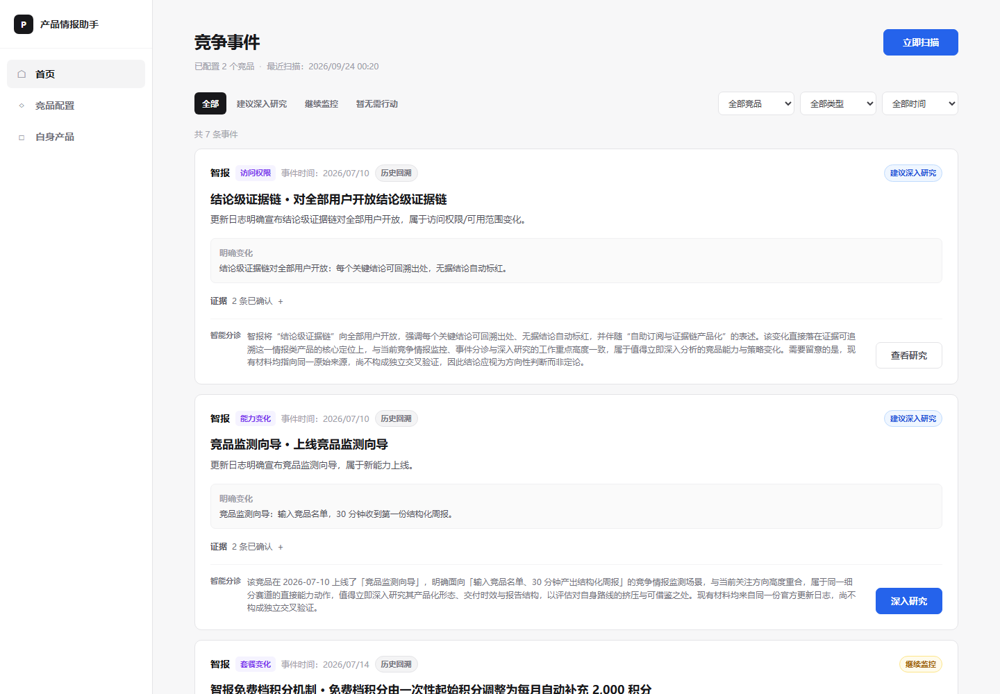
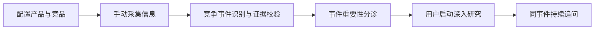

# PIA｜产品智能研究助手

**Product Intelligence Agent（PIA）是个人完成的 AI（人工智能）产品 MVP（最小可行产品），帮助产品经理发现具有竞争意义的竞品变化，并基于可核查证据开展深入研究。**

面向产品经理、研究人员和需要关注竞品的业务团队。已实现前后端完整流程，代码开发使用 AI 编码工具辅助；当前本地单用户运行，扫描由用户触发，深入研究由用户选择启动。

## 为什么做

问题观察：竞品信息散落在产品页、价格页和更新日志中。读到变化后，还需要判断它是否重要、与自身产品有什么关系，以及依据是否可靠。

产品假设：把采集、判断和研究串起来，可以减少人工切换与整理。项目尚无规模化用户验证、商业收益或效率提升比例结论。

## 用户怎样使用

支持资料上传、来源发现、事件筛选与关注偏好管理。报告和对话分别保存，引用可以展开核查。[查看五类真实界面](docs/demo.md)

## 关键 AI 产品设计

| 问题 | 设计与取舍 |
|---|---|
| 网页变化就是事件吗？ | 普通首次扫描只建基线；比较同项前后状态，或使用官方明确变化声明；不足则保留“不确定”。 |
| 哪一步需要 Agent（智能体）？ | 分诊采用固定工作流；研究才按证据缺口选择工具，由程序限制预算与校验引用。 |
| 模型怎样理解产品背景？ | RAG（检索增强生成）分开检索自身与竞品知识，避免混淆能力归属。 |
| 怎样保持关注连续性？ | Memory（长期记忆）保存用户意图，自动识别须确认，不能作为产品事实证据。 |
| 怎样验证 AI？ | Evaluation（评测）区分软件、链路与模型质量，冻结数据、防止答案泄漏并保留失败案例。 |

程序管理状态、数据作用域、工具调用与证据；模型负责语义判断和研究计划。没有登录或企业权限系统。

## 如何验证

2026-09-29验收记录：后端 **670/670**、前端 **47/47**，类型检查与构建通过。软件通过不等于模型准确率。

最终新12条留出各执行一次：决策12/12、类型4/7，另有日期与归纳问题。非随机小样本、专家模型标注且未经真人复核，不能宣称整体准确率100%。旧35条已用于开发，后续分数不再独立。[方法与失败案例](docs/evaluation.md)

## 深入阅读与运行

- **产品设计**：[关键产品决策](docs/product_decisions.md)。
- **AI能力与架构**：[模型与程序分工](docs/ai_architecture.md)。
- **验证方法**：[评测与失败案例](docs/evaluation.md)。
- **项目分工**：[个人产品经理贡献](docs/product_manager_contribution.md)。
- **体验与复现**：[演示、截图和完整配置](docs/demo.md)。
- **技术实现**：[事实索引](docs/PIA_MVP_Implementation_Fact_Index.md) · [详细架构](docs/final_architecture.md) · [历史最终验收](docs/final_closure_report.md)。

## 当前边界

本地单进程、手动扫描，无定时调度、登录权限、通知、扫描件文字识别或生产服务承诺。引用可追溯不等于语义完全正确；研究与记忆尚无独立质量评测。内部资料可能发送到配置的外部模型服务，使用前须评估是否允许外发。
