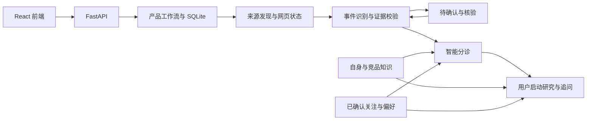

# PIA 产品智能研究助手

PIA 是面向产品经理与研究人员的 PC Web MVP：持续积累竞品状态，识别有竞争意义的变化，并把证据、关注优先级与事件研究串成可追溯的工作流。

网页变化不等于竞争事件。首次普通扫描只建立历史基线；官方明确变化声明可以独立进入事件识别。证据不足的变化保持待确认，研究建议由用户决定是否执行。

## 可以完成什么

1. 配置竞品名称和官方地址，由来源发现 Agent 查找可监控页面。
2. 上传自身产品 DOCX、PDF、XLSX、Markdown 或 TXT 资料，按需替换当前版本。
3. 设置当前关注重点，管理长期关注与偏好；自动识别的信息经用户确认后才生效。
4. 手动扫描，查看事件、前后状态、已确认来源和智能分诊。
5. 启动深入研究，在同一页面阅读初始成果并继续追问；通过正文引用核对来源。报告与对话分别持久保存。

## 架构



程序管理身份、状态、权限范围、引用及事务；模型负责语义判断和研究计划。知识检索使用 Embedding + Rerank，Memory 不作为产品事实证据。没有为了形式引入多智能体调度或分布式工作流。

## 本地运行

要求 Python 3.13、Node.js 22 或兼容版本，以及可用的模型和搜索服务配置。以下为 PowerShell 示例，两个服务分别在终端运行。

```powershell
python -m venv .venv
.venv\Scripts\python.exe -m pip install -r requirements.txt
.venv\Scripts\python.exe -m playwright install chromium
.venv\Scripts\python.exe -m uvicorn api.main:app --host 127.0.0.1 --port 8000
```

```powershell
cd frontend
npm ci
npm run dev -- --host 127.0.0.1
```

打开 http://localhost:5173。前端代理后端 8000；不要把模型凭据放进前端构建配置。浏览器后备采集需要 Chromium。状态默认保存在 `.pia-state/`，可通过进程环境 `PIA_STATE_DIR` 指定本地目录。

配置由本地环境提供，不随仓库分发：

- Default/Fast：`LLM_PROVIDER`、`LLM_BASE_URL`、`LLM_MODEL`、`LLM_API_KEY`。
- Reasoning：`LLM_REASONING_PROVIDER`、`LLM_REASONING_BASE_URL`、`LLM_REASONING_MODEL`，对应角色或供应商凭据。
- 检索：`EMBEDDING_PROVIDER`、`EMBEDDING_MODEL`、`RERANK_PROVIDER`、`RERANK_MODEL`，匹配供应商凭据和地址；当前检索适配为阿里云百炼。
- 搜索使用腾讯 WSA，需 `WSA_API_KEY`；网页配置以 `source_discovery/` 和现有本地配置为准；缺少配置会明确失败，不静默切换模型。

## 验证与评测

```powershell
.venv\Scripts\python.exe -m unittest discover -s tests -q
cd frontend
npm test
npm run typecheck
npm run build
```

软件测试证明流程、持久化和契约。真实模型评测单独报告，不把测试通过率当作 AI 准确率。旧 35 条已用于开发回归，不能再称独立成绩。最终留出集遵循 RC → 空候选冻结 → 专家模型标注冻结 → 一次性执行。

详见 [评测历史与结果](evals/docs/event_detection_evaluation_lineage.md)。动态评测输出留在本地 `tmp/`。

## 阅读与演示

- [真实实现事实索引](docs/PIA_MVP_Implementation_Fact_Index.md)：能力、API、持久化与源码入口。
- [架构与设计理由](docs/final_architecture.md)：事件、证据、RAG、记忆、研究及可靠性。
- [Demo 指南](docs/demo_guide.md)：运行、演示路径与失败时的解释。
- [Word 实现报告](docs/PIA_MVP_Current_Implementation_Report.docx)：适合学习与项目讲解。

各 V0.1、Repair 文档是阶段验收记录；当前行为以事实索引和真实代码为准。

## MVP 边界

当前是本地单进程、人工触发扫描的产品 MVP，没有定时调度、登录/RBAC、消息通知、OCR 或生产 SLA。服务只应绑定可信本机环境。网页防护不是生产级 DNS/出口隔离。内部产品资料可能发送给已配置的模型与检索服务，企业使用须评估数据分级、脱敏、供应商协议及部署策略。

引用逐字校验保证可追溯性，不等于完全验证语义蕴含。模型仍会漏报、误分和生成不合格结构；系统保留失败与不确定性，不自动伪造证据或补全日期。
