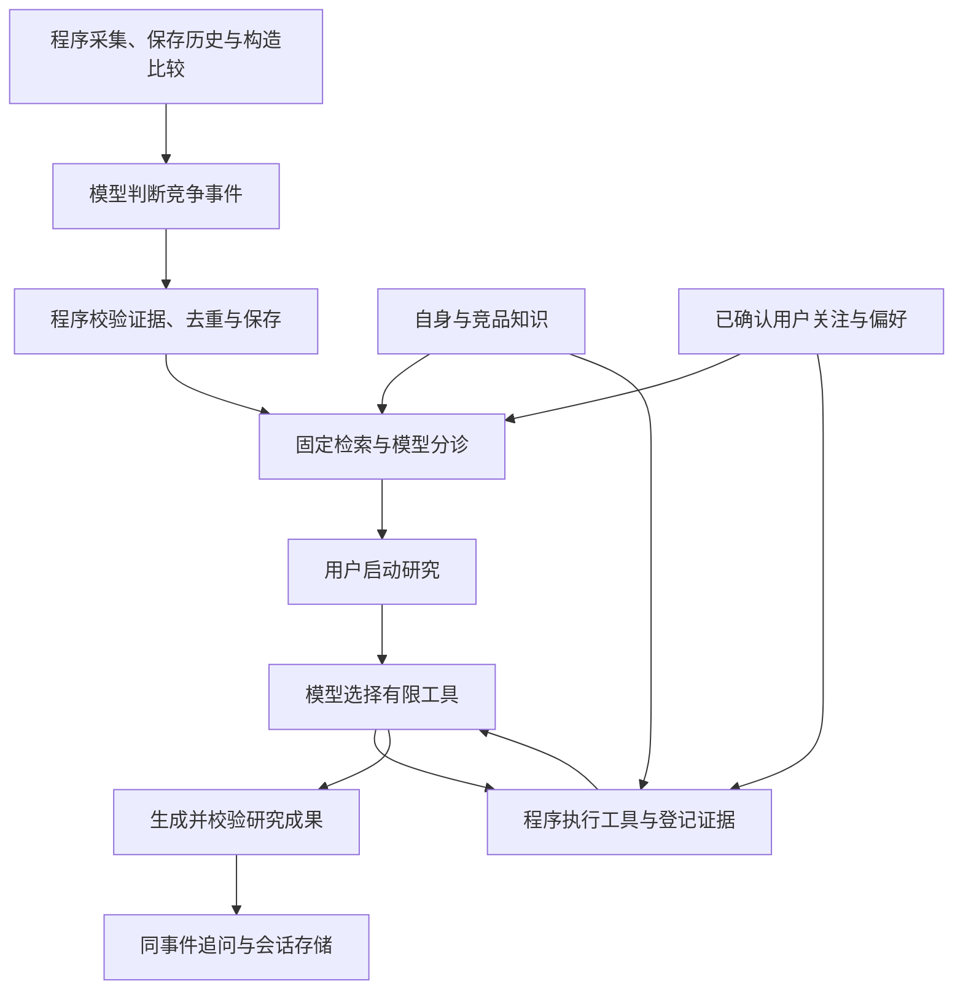

# PIA 的 AI（人工智能）能力与程序分工

PIA（Product Intelligence Agent，产品智能研究助手）帮助产品经理发现具有竞争意义的竞品变化，并基于可核查证据开展深入研究。本文解释 AI（人工智能）能力与程序的职责分工，状态与存储细节见[完整架构](final_architecture.md)。

运行结构：React（界面库）与 TypeScript（带类型检查的编程语言）前端 → FastAPI（Python编程语言的接口框架）后端 → SQLite（本地数据库）与业务模块。模型和搜索服务由后端调用，前端不持有凭据。

## 能力放在什么位置

## 模型与程序怎样分工

| 环节 | 模型负责 | 程序负责 |
|---|---|---|
| 事件识别 | 变化含义、竞争意义、类型与不确定性 | 比较资格、输入材料、引用与保存 |
| 分诊 | 结合产品背景和关注给建议 | 固定检索、绑定事件、控制执行入口 |
| Agent（智能体）研究 | 按缺口选择下一步工具、组织回答 | 工具白名单、预算、范围与引用校验 |
| Memory（长期记忆） | 从用户原文抽取长期意图 | 待确认、生命周期和召回范围 |

模型通过 Tool Calling（工具调用）选择搜索、读页、竞品知识、自身知识或记忆检索。读页只接受已登记线索，不能任意生成地址。搜索摘要读到原文后才能作为事实引用。

## 为什么需要分域检索

RAG（检索增强生成）补充模型缺少的产品背景。Own Product Knowledge（自身产品知识）与 Competitor Knowledge（竞品知识）分域，先过滤范围，再向量召回和重排序。

自身资料只检索当前版本；整份替换成功后生效，失败保留旧版。资料不足不能推断产品没有某能力。当前使用 SQLite（本地数据库）存储并检索向量，没有大型专用向量数据库。

## 三种上下文不能混用

- **产品事实：**来自自身资料或竞品证据，需要来源支持。
- **用户意图：**来自当前关注与已确认长期偏好，影响优先级，不证明产品事实。
- **研究上下文：**来自初始报告、已有引用和当前事件对话，不等于自动写入长期记忆。

## 可靠性边界

Evidence（证据）登记与逐字校验提高可追溯性，不能保证全部语义正确。程序先可靠保存正式处理结果，再推进状态比较进度；研究成果与追问分别保存。

数据作用域与工具校验不是用户权限系统。当前为本地单进程、单用户 MVP（最小可行产品），没有登录、企业角色权限或生产网络隔离。内部资料可能发送到外部模型服务。

## 真实实现入口

[事件识别](../event_core/detector.py) · [分诊](../triage/workflow.py) · [研究](../research/agent.py) · [工具](../research/tools.py) · [知识检索](../knowledge/retrieval.py) · [长期偏好](../memory/product.py) · [产品流程](../pipeline/orchestrator.py)
