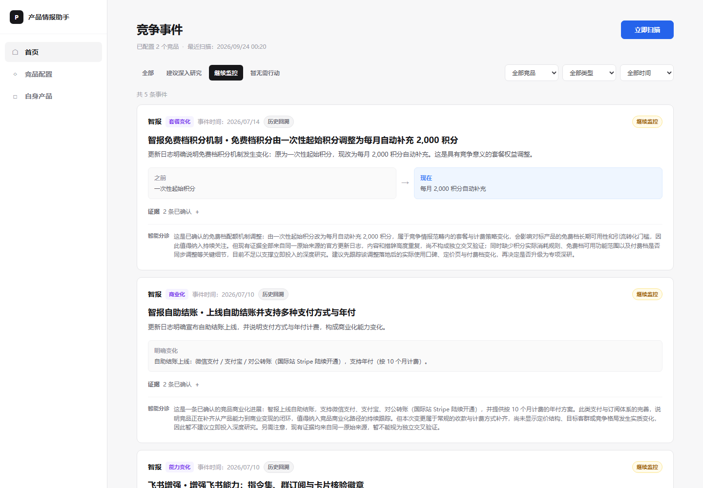
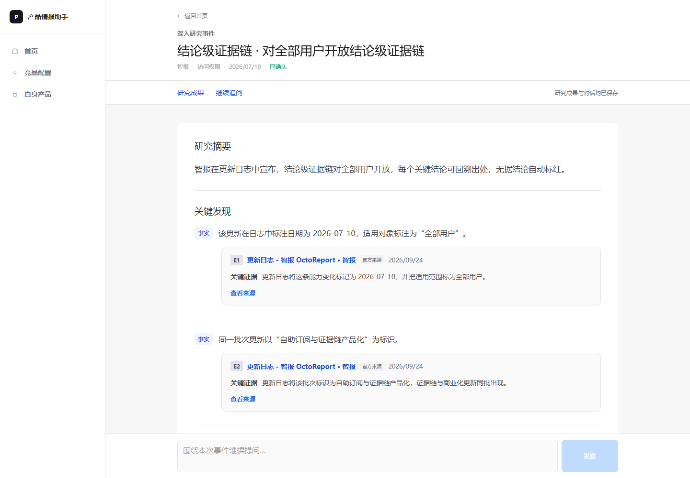
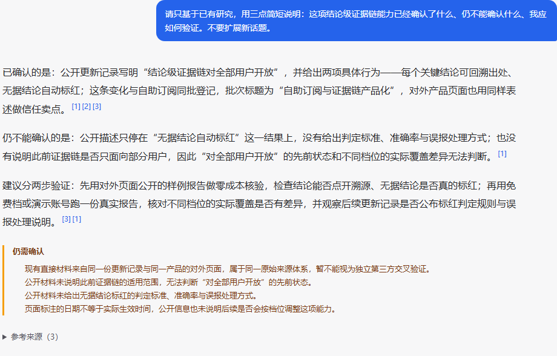
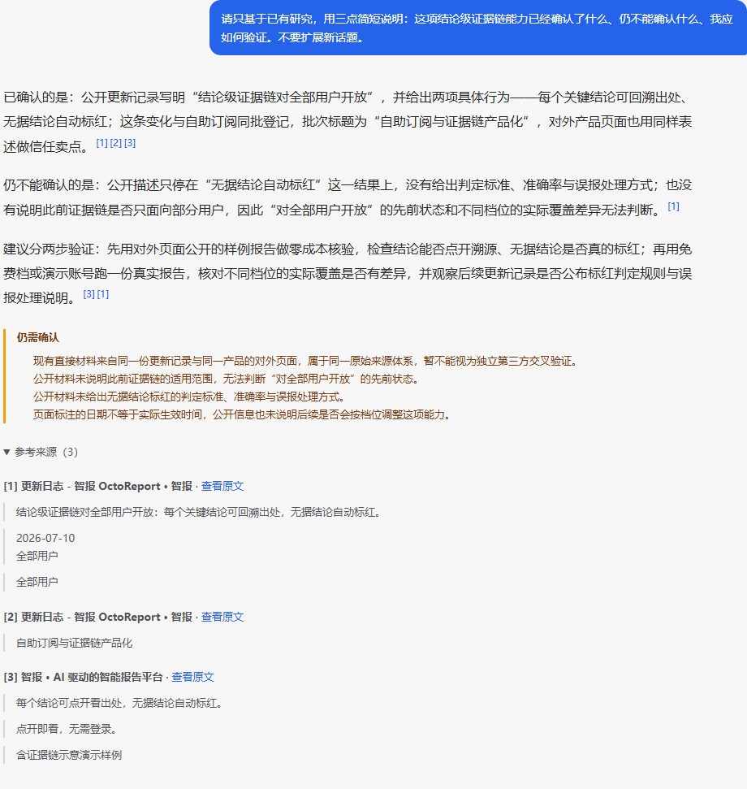

# PIA 产品演示与本地体验

PIA（Product Intelligence Agent，产品智能研究助手）帮助产品经理发现具有竞争意义的竞品变化，并基于可核查证据开展深入研究。当前为个人 MVP（最小可行产品），没有托管在线演示服务。截图来自本地真实前后端与既存持久化数据。

## 五类界面，展示一条完整路径

### 1. 产品首页

查看竞争事件与关注建议；扫描由用户触发，不是后台定时服务。


### 2. 事件列表

列表就在首页，可按竞品、类型、时间与分诊筛选。未知发生时间不能用观察时间冒充。



### 3. 初始研究成果

用户启动后形成独立报告。再次进入已完成成果无需重跑模型。



### 4. 同页继续追问

Follow-up Research（事件内继续追问）围绕当前事件延伸；成果与对话同页，历史不覆盖报告。



### 5. 核查引用

行内编号展开来源与原文，帮助核查事实；引用可追溯不等于归纳全部正确。



## 本地运行与配置

要求 Python（编程语言）3.13、Node.js（前端运行环境）22.12及以上的22.x，或依赖支持的24.x版本。准备模型、检索与搜索服务；调用可能计费，内部资料外发须先评估。

在仓库根目录使用 PowerShell（命令行环境）：

```powershell
python -m venv .venv
.venv\Scripts\python.exe -m pip install -r requirements.txt
.venv\Scripts\python.exe -m playwright install chromium
# 只在没有配置时创建，避免覆盖已有 .env。
if (!(Test-Path -LiteralPath .env)) { Copy-Item -LiteralPath .env.example -Destination .env }
```

填写本地配置，启动后端：

```powershell
.venv\Scripts\python.exe -m uvicorn api.main:app --host 127.0.0.1 --port 8000 --env-file .env
```

另开终端启动前端：

```powershell
cd frontend
npm ci
npm run dev -- --host 127.0.0.1
```

访问 `http://localhost:5173`，前端代理后端8000。数据默认保存在被忽略的 `.pia-state/`，凭据只放后端。

### 配置按代码真实读取逻辑填写

| 配置 | 规则 |
|---|---|
| `LLM_*` | Default/Fast（默认与快速角色）共用供应商、模型、基础地址和密钥 |
| `LLM_REASONING_*` | Reasoning（推理角色）独立配置，密钥优先角色密钥，再取供应商大写名称的 `*_API_KEY` |
| `LLM_RESEARCH_*` | Research（研究角色）独立配置，密钥只取供应商的 `*_API_KEY`；没有 `LLM_RESEARCH_API_KEY` |
| `EMBEDDING_*`、`RERANK_*` | Embedding（向量化）与 Rerank（重排序）仅支持 `aliyun_bailian`，地址推导见模板 |
| `WSA_API_KEY` | 腾讯 WSA（网页搜索服务）凭据 |
| `PIA_STATE_DIR`、`PIA_CORS_ORIGINS`、`PIA_ENABLE_TEST_RESET` | 均读取进程环境：状态目录在首次服务初始化时读取，跨域来源在创建应用时读取，重置开关在请求检查时读取 |

`--env-file .env` 让 Uvicorn（后端服务启动器）先加载配置再导入应用。仅靠模型客户端稍后加载文件，不能保证创建应用时的跨域设置及时生效。已有进程环境优先，模板没有可直接运行的默认模型。

前端默认通过本地代理访问后端，工作区为 `default`、产品为 `main`。可选 `VITE_API_BASE_URL`、`VITE_PIA_WORKSPACE_ID` 和 `VITE_PIA_PRODUCT_ID` 由前端环境读取，根目录模板不自动配置它们。工作区和产品编号不能作为安全认证。

## 首次体验顺序

自身产品与关注 → 添加竞品并发现来源 → 手动扫描 → 查看事件与证据 → 对建议研究的事件主动启动 → 同页追问 → 展开引用并刷新恢复。

普通首次扫描只建基线，不保证立即产生事件。资料不足或外部服务失败应如实展示。运行数据库不随仓库分发，新环境不会自动出现截图中的历史成果。

## 软件检查入口

```powershell
.venv\Scripts\python.exe -m unittest discover -s tests -q
cd frontend
npm test
npm run typecheck
npm run build
```

软件检查与模型质量评测分开，不为看演示重跑已冻结的一次性评测。历史真实走查见[原验收记录](demo_guide.md)，质量边界见[评测说明](evaluation.md)。
